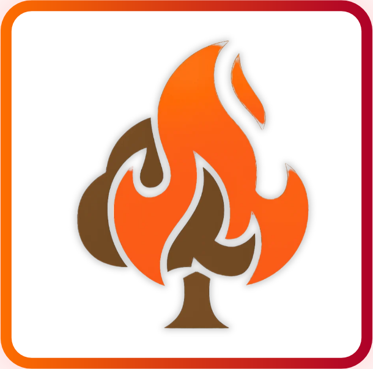
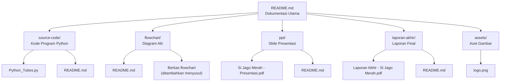

# Si Jago Merah

**Simulasi Sistem Pemadaman Kebakaran Hutan**

Tugas Besar 01 — WI1102 Berpikir Komputasional
Kelompok 01 · K-34 · Semester 1 2026/2027
Sekolah Teknik Elektro dan Informatika (STEI-K), Institut Teknologi Bandung

<p align="center">
  
</p>

---

## Daftar Isi

- [Tentang Proyek](#tentang-proyek)
- [Anggota Kelompok](#anggota-kelompok)
- [Latar Belakang Singkat](#latar-belakang-singkat)
- [Cara Kerja Simulasi](#cara-kerja-simulasi)
- [Aturan Simulasi](#aturan-simulasi)
- [Peta Repositori (Alur Path)](#peta-repositori-alur-path)
- [Cara Menjalankan](#cara-menjalankan)
- [Empat Pilar Berpikir Komputasional](#empat-pilar-berpikir-komputasional)
- [Teknologi](#teknologi)
- [Batasan dan Arah Pengembangan](#batasan-dan-arah-pengembangan)

---

## Tentang Proyek

**Si Jago Merah** adalah program simulasi berbasis terminal yang memodelkan penyebaran
kebakaran hutan pada grid 10×10 dan upaya pemadaman oleh satu unit truk pemadam.
Api menyebar dari pohon ke pohon mengikuti arah dan kecepatan angin, sementara truk
bergerak menuju pohon terbakar terdekat untuk memadamkannya.

Simulasi berjalan per **tick** dan menampilkan kondisi grid di setiap tick, sehingga
proses penyebaran api maupun pergerakan truk dapat diamati langkah demi langkah.
Program diakhiri dengan rekap jumlah pohon yang selamat, padam, basah, dan hangus.

Repositori ini berisi seluruh luaran tugas besar: kode program, flowchart, slide
presentasi, dan laporan akhir, yang masing-masing dijelaskan pada README di foldernya.

## Anggota Kelompok

| No | Nama | NIM |
|:--:|------|-----|
| 1 | Aksa Rachman | 19626104 |
| 2 | Mahesa Rahasia Hati Kahfilano | 19626020 |
| 3 | Davin Gusti Nurandi | 19626014 |
| 4 | Fathyakan Thorique Zidane | 19626038 |

**Dosen Pembimbing:** Muhammad Shiddiq Sayyid Hashuro, S.T., M.Eng., Ph.D.

## Latar Belakang Singkat

Kebakaran hutan dan lahan (karhutla) menjadi salah satu bencana yang paling banyak
dilaporkan di Indonesia. Penanganannya dipengaruhi banyak faktor yang saling berkaitan,
mulai dari karakteristik lahan, kondisi iklim, hingga keterbatasan akses dan sumber
daya pemadaman. Kompleksitas ini membuat penyebaran api sulit diprediksi dan keputusan
pemadaman sulit ditentukan, sementara percobaan langsung pada kebakaran sesungguhnya
tidak mungkin dilakukan karena berbahaya dan berbiaya tinggi.

Oleh karena itu, **Si Jago Merah** hadir sebagai sarana simulasi yang aman untuk
mempelajari bagaimana api menyebar dan bagaimana strategi pemadaman bekerja pada
berbagai skenario. Dari sekian banyak faktor, simulasi ini berfokus pada **arah dan
kecepatan angin** sebagai penentu peluang penyebaran api, serta **satu truk pemadam**
yang bergerak menuju pohon terbakar terdekat.

## Cara Kerja Simulasi

Pengguna memasukkan jumlah titik api, posisi awal truk, koordinat setiap titik api,
arah angin, dan kecepatan angin. Setelah semua parameter siap, program masuk ke main
loop yang berjalan per tick. Setiap tick menjalankan lima tahap berurutan:

1. **Update burn timer** — menambah burn timer setiap pohon yang terbakar atau sedang
   dipadamkan, sekaligus mengubah pohon yang terlalu lama terbakar menjadi hangus.
2. **Hitung penyebaran api** — bila `tick % 5 == 0`, api dicek untuk menyebar ke arah
   searah angin dan dua arah tegak lurus angin.
3. **Terapkan penyebaran** — hasil perhitungan diterapkan sekaligus ke grid melalui
   array sementara `akan_terbakar`, sehingga tidak terjadi rantai penyebaran dalam
   satu tick.
4. **Update truk** — truk bergerak menuju target atau memadamkan area bila sudah
   sampai.
5. **Cek terminasi** — bila tidak ada lagi pohon berstatus `terbakar` maupun
   `sedang dipadamkan`, program menampilkan rekap akhir dan berhenti.

## Aturan Simulasi

| Aturan | Keterangan |
|--------|------------|
| Ukuran grid | 10 × 10 petak, satu sel mewakili satu pohon |
| Kondisi pohon | `sehat`, `terbakar`, `sedang dipadamkan`, `basah`, `padam`, `hangus` |
| Waktu | Diskrit, satu satuan disebut **tick** |
| Penyebaran api | Setiap 5 tick (`tick % 5 == 0`), ke arah searah angin dan dua arah tegak lurus |
| Arah angin | `N` (atas), `S` (bawah), `E` (kanan), `W` (kiri) |
| Burn timer | +1 per tick untuk pohon `terbakar` / `sedang dipadamkan`; mencapai batas → `hangus` |
| Pergerakan truk | 1 petak per tick menuju pohon terbakar terdekat (Manhattan Distance) |
| Tie-breaker | Jika jarak sama, dipilih pohon dengan skor bahaya tertinggi |
| Skor bahaya | +1 per tetangga sehat, +1 tambahan bila searah angin, +5 per tetangga terbakar |
| Area pemadaman | 3 × 3 petak di sekitar truk; `terbakar` → `sedang dipadamkan`, `sehat` → `basah` |
| Lama pemadaman | 3 tick, lalu `sedang dipadamkan` → `padam` |
| Kondisi berhenti | Tidak ada lagi pohon `terbakar` atau `sedang dipadamkan` |

**Parameter berdasarkan kecepatan angin:**

| Kecepatan | Peluang searah angin | Peluang tegak lurus | Batas hangus |
|-----------|:--------------------:|:-------------------:|:------------:|
| Rendah | 30% | 3% | 15 tick |
| Sedang | 60% | 6% | 12 tick |
| Tinggi | 70% | 7% | 10 tick |

## Peta Repositori (Alur Path)

Alur dokumentasi repositori ini dimulai dari README utama, lalu bercabang ke folder
luaran tugas besar. Setiap folder memiliki README sendiri yang menjelaskan isinya.



**Struktur direktori:**

```text
Tugas Besar 01 Berpikir Komputasional/
├── README.md                  # Dokumentasi utama dan peta navigasi
├── .gitignore
├── assets/
│   └── logo.png               # Logo Si Jago Merah
├── source-code/
│   ├── README.md              # Penjelasan kode dan cara menjalankan
│   └── Python_Tubes.py        # Program simulasi
├── flowchart/
│   └── README.md              # Penjelasan dan daftar flowchart
├── ppt/
│   ├── README.md              # Penjelasan slide presentasi
│   └── Si Jago Merah - Presentasi.pdf
└── laporan-akhir/
    ├── README.md              # Penjelasan laporan akhir
    └── Laporan Akhir - Si Jago Merah.pdf
```

**Navigasi cepat:**

| Path | Isi | Tautan |
|------|-----|--------|
| `source-code/` | Kode program Python dan penjelasan fungsi | [Buka README](source-code/README.md) |
| `flowchart/` | Diagram alir program dan subprogram | [Buka README](flowchart/README.md) |
| `ppt/` | Slide presentasi tugas besar | [Buka README](ppt/README.md) |
| `laporan-akhir/` | Laporan akhir lengkap (PDF) | [Buka README](laporan-akhir/README.md) |

## Cara Menjalankan

**Prasyarat:** Python 3.x (disarankan 3.8 atau lebih baru). Tidak ada dependensi
eksternal; program hanya memakai modul bawaan `random` dan `time`.

```bash
git clone <url-repositori-anda>
cd "Tugas Besar 01 Berpikir Komputasional"
python source-code/Python_Tubes.py
```

Contoh skenario (sesuai demo pada laporan):

| Input | Nilai |
|-------|-------|
| Jumlah titik api | `4` |
| Posisi awal truk (baris, kolom) | `0`, `3` |
| Titik api 1 | baris `0`, kolom `4` |
| Titik api 2 | baris `1`, kolom `5` |
| Titik api 3 | baris `3`, kolom `9` |
| Titik api 4 | baris `7`, kolom `2` |
| Arah angin | `S` |
| Kecepatan angin | `sedang` |

> **Catatan terminal:** program menampilkan emoji. Gunakan terminal yang mendukung
> UTF-8. Jika emoji tidak tampil, jalankan dengan
> `PYTHONIOENCODING=utf-8 python source-code/Python_Tubes.py` (Linux/macOS) atau
> `$env:PYTHONIOENCODING="utf-8"; python source-code/Python_Tubes.py` (PowerShell).

Penjelasan lebih rinci mengenai fungsi dan alur kode tersedia di
[`source-code/README.md`](source-code/README.md).

## Empat Pilar Berpikir Komputasional

| Pilar | Penerapan dalam Si Jago Merah |
|-------|-------------------------------|
| **Dekomposisi** | Memecah masalah menjadi input, simulasi per tick, dan visualisasi/rekap. |
| **Pengenalan Pola** | Pola penyebaran api searah angin, perubahan kondisi pohon yang satu arah, burn timer, dan pergerakan truk. |
| **Abstraksi & Generalisasi** | Hutan menjadi grid 10×10, angin menjadi 4 arah dan 3 kecepatan, waktu menjadi tick, pohon diseragamkan, armada menjadi satu truk. |
| **Algoritma** | Main program per tick dan subprogram untuk tampilan, perhitungan, perubahan kondisi pohon, serta pengendalian truk. |

Uraian lengkap tersedia pada BAB 2 di
[`laporan-akhir/`](laporan-akhir/README.md).

## Teknologi

- **Bahasa:** Python 3
- **Modul bawaan:** `random` (probabilitas penyebaran), `time` (jeda antar-tick)
- **Antarmuka:** terminal / command line (grid emoji)
- **Dokumentasi:** Markdown + Mermaid

## Batasan dan Arah Pengembangan

**Batasan saat ini:**

- Grid 10×10 masih *hardcoded*.
- Hanya satu unit truk dan air tak terbatas.
- Angin statis sepanjang simulasi.
- Penyebaran api hanya tiga arah (tanpa upwind).
- Semua pohon identik, tanpa terrain (sungai, jalan, bukit, rawa).
- Basah bersifat permanen dan pohon padam tidak dapat menyala kembali.
- Simulasi belum *reproducible* (tanpa seed) dan belum menyimpan state per tick.

**Arah pengembangan:**

- Grid dinamis dan config eksternal (JSON/YAML/argparse).
- Peta dari file dan pathfinding A*/BFS.
- Multi-truk, unit udara, dan kapasitas air dengan fase isi ulang.
- Angin dinamis, penyebaran 8 arah, basah mengering, dan *reignite*.
- Variasi jenis pohon serta fitur *record & replay*.

Daftar lengkap ada pada BAB 3 di
[`laporan-akhir/`](laporan-akhir/README.md) dan
[`ppt/`](ppt/README.md).
